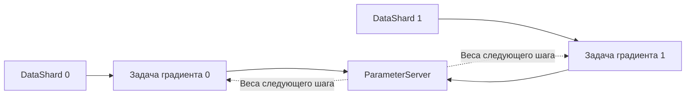

# Описание проекта

[Задание P25-B «Ray: акторы и восстановление»](https://distsys.ru/osukhoroslov/nis2/src/branch/main/project-tasks/p25-b-ray-actors-recovery.md).
Команда №10: Зодоров Адам, Царапкин Максим, Шиляев Иван.
Основная статья — [Ray: A Distributed Framework for Emerging AI Applications, OSDI 2018](https://www.usenix.org/conference/osdi18/presentation/moritz).

## Задача

После перезапуска обучение может продолжиться с неправильного состояния:
например, веса уже обновлены, а позиция в данных осталась от прошлого шага.
Проверим, как вместе восстанавливать веса, momentum оптимизатора,
номер шага и позиции источников.

Выбрали путь с авторским артефактом: используем Ray
[назначенного коммита](checkpoints/01.md#ресурсы). Приложение из акторов и задач,
журнал шагов и проверка уже работают без сбоев. Следующий этап — добавить
два способа восстановления и повторить приложение на `multiprocessing`
с очередями для сравнения с Ray.

Нагрузка — синхронное обучение небольшой ConvNet на MNIST. За основу взят
[пример parameter server из Ray](https://github.com/ray-project/ray/blob/2ff4d94078ee94b3c9e6e4552ad84f78bad7f75f/doc/source/ray-core/examples/plot_parameter_server.ipynb).
Добавили отдельные источники данных, SGD с momentum, фиксированный
порядок батчей, ID шагов, журнал и последовательный эталон.
PyTorch считает градиенты, torchvision загружает данные.
[Источники и лицензии](../README.md#источники-и-лицензии).

## Устройство приложения

`DataShard` — актор, который хранит позицию в своей части MNIST и текущий
батч. `ParameterServer` хранит веса, momentum и номер применённого шага.
Градиенты считают обычные Ray-задачи. Координатор запускает шаги и пишет журнал.
В нём же добавим вызов сбоев в заданных точках.

Один шаг устроен так:

1. `DataShard.reserve(step)` выбирает и резервирует индексы изображений.
2. Координатор кладёт текущие веса в объектное хранилище через `ray.put`.
3. Задачи `compute_gradient` читают батчи у источников и считают градиенты
   на одной версии весов.
4. `ParameterServer.apply` проверяет номера шагов и источников, усредняет
   градиенты в порядке номеров shard и выполняет шаг SGD с momentum.
5. `DataShard.commit(step)` продвигает позиции данных. Координатор записывает
   батчи, версии, время шага и хеш новых весов.

Следующий шаг начинается после завершения предыдущего. По умолчанию работают
два вычислителя с батчами по 32 изображения. В каждом процессе PyTorch
использует один CPU-поток; seed задан явно.

В пилоте отключены рестарты акторов и повторы задач. Повтор текущего
`reserve`/`commit` обрабатывается, пока жив процесс; `apply` отвергает
неожиданный номер шага. Обработку повторов после восстановления ещё нужно добавить.

| Файл | За что отвечает |
| --- | --- |
| [model.py](../ray_ps/model.py) | Нейросеть, настройки CPU и функции работы с состоянием |
| [pilot.py](../ray_ps/pilot.py) | Акторы, расчёт градиентов и цикл обучения |
| [verify.py](../ray_ps/verify.py) | Последовательное обучение и сравнение результатов |
| [check_results.py](../ray_ps/check_results.py) | Повторяемость запусков и обнаружение повреждённого momentum |
| [recovery_probe.py](../examples/recovery_probe.py) | Замер восстановления и задержек на счётчике |
| [test_pilot_verification.py](../tests/test_pilot_verification.py) | Проверки пропусков, дублей, батчей и перехода эпох |
| [test_counter_checkpoint.py](../tests/test_counter_checkpoint.py) | Проверки чтения checkpoint и ошибок записи |

Команды запуска — в [README](../README.md#запуск-и-проверка-пилота),
результаты пилота — в [КТ1](checkpoints/01.md).

## Файлы запуска

| Файл результата | Содержимое |
| --- | --- |
| `config.json` | Параметры, версии, seed, хеши данных и исходников |
| `steps.jsonl` | Батчи, номера шагов и версий модели, позиции источников, время и хеши весов |
| `summary.json` | Итог запуска и p95/p99 времени шага |
| `final-state.pt` | Веса, momentum, номер шага и позиции источников |
| `verification.json` | Результат проверки по последовательному эталону |

`completed_pending_independent_verification` в `summary.json` означает, что
программа завершилась. Результат проверки нужно смотреть в `verification.json`:
`verify` перезаписывает его и при успехе, и при ошибке.
`check_results` сравнивает два запуска и проверяет, что намеренно испорченный
momentum обнаруживается. Исходные результаты при этом не меняются.

## Сбои и восстановление

Сравним две стратегии:

- **Restart:** Ray запускает процесс заново, прикладное состояние сбрасывается.
- **Checkpoint/replay:** процесс загружает снимок состояния и применяет
  обновления из журнала, записанные после снимка.

Проверим работу без сбоев и три вида отказов: вычислительная задача падает
во время расчёта градиента; сервер модели — после подтверждённого шага;
источник данных — с зарезервированным, но ещё не подтверждённым батчем.
Worker здесь — процесс обычной Ray-задачи.

В checkpoint будем сохранять веса, momentum, номер шага, прогресс источников,
незавершённые батчи и уже применённые запросы. В журнал — усреднённый градиент,
ID шага, базовую версию модели и ID батчей. Подтверждение отправим после записи
журнала на диск, чтобы при replay применить обновление без повторного расчёта
градиентов.

Отдельно проверим потерю ответа: сервер применил шаг, но упал до отправки
ответа. Клиент повторит запрос с тем же ID, а сервер должен вернуть прежний
результат без повторного применения. Позиции источников должны соответствовать
этому шагу. Незавершённый шаг восстановим по журналам сервера и источников.

## Что должно получиться

| Результат | Как проверим |
| --- | --- |
| Приложение из нескольких акторов и задач | Отдельные PID, согласованные версии модели и позиции источников в журнале |
| Restart и checkpoint/replay | Перезапуск процесса; сравнение восстановленного состояния с эталоном, учёт потерь |
| Управляемые отказы задачи, сервера и источника | Известная точка сбоя, PID до/после, журнал попыток и первый правильный шаг после восстановления |
| Журнал и защита от двойного применения | ID операций и попыток, хеши состояния; проверки пропусков, дублей и потерянного ответа |
| Вариант на обычных процессах (baseline) | Те же данные, алгоритм обучения, правила сохранения и ресурсы, что у Ray |
| Независимая проверка | Точное сравнение ID и прогресса, сравнение весов и momentum с допуском; намеренно испорченный результат должен быть отвергнут |
| Эксперименты и разбор результатов | Не менее трёх серий с повторами, сырые журналы, скрипт обработки, таблицы и графики восстановления, задержек и повторной работы |

Конфигурации и метрики заданы в [плане эксперимента](experiment-plan.md).

## Упрощения

Работаем на одной машине и только на CPU. В каждом запуске вызываем один
отказ процесса. Координатор, Ray head/GCS и локальный диск продолжают работать,
новый процесс читает тот же диск. Отказы машины, питания и диска, сетевые
разделения и одновременные отказы нескольких процессов в основной план не входят.

Обучение синхронное, порядок данных и агрегации фиксирован. Численные результаты
сравниваем в одной среде с заранее выбранным допуском. Loss используем
для наблюдения за обучением, а правильность проверяем по полному состоянию.

По этим опытам сможем сравнить восстановление нашего приложения после отказа
отдельного процесса на одной машине.
