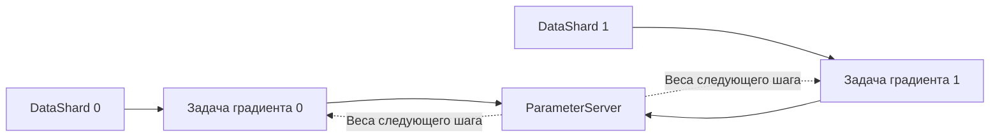

# Описание проекта

## Назначенное задание

[P25-B «Ray: акторы и восстановление»](https://distsys.ru/osukhoroslov/nis2/src/branch/main/project-tasks/p25-b-ray-actors-recovery.md),
команда №10: Зодоров Адам, Царапкин Максим, Шиляев Иван.
Статья: [Ray: A Distributed Framework for Emerging AI Applications, OSDI 2018](https://www.usenix.org/conference/osdi18/presentation/moritz).

Приложение: синхронное обучение небольшой нейросети на MNIST с parameter
server. Проверяем, какое прикладное состояние нужно сохранять и как меняются
правильность и стоимость продолжения обучения после отказов процессов.
Это рабочая постановка КТ1 для просмотра командой.

## Выбранный технический путь

**Авторский артефакт как runtime собственного приложения.** Используем Ray
Core из назначенной ревизии `2ff4d94078ee94b3c9e6e4552ad84f78bad7f75f`.
Реализуем приложение, стратегии сохранения, инъекцию отказов, процессный
baseline и проверяющий инструмент. Ray и алгоритм автоматического
дифференцирования заново не реализуем.

Основа — [официальный пример parameter server в этой ревизии](https://github.com/ray-project/ray/blob/2ff4d94078ee94b3c9e6e4552ad84f78bad7f75f/doc/source/ray-core/examples/plot_parameter_server.ipynb).
Архитектура небольшой ConvNet адаптирована с указанием [источников и лицензии](../THIRD_PARTY.md).
PyTorch считает градиенты; torchvision загружает MNIST.

Наши изменения относительно примера: отдельные stateful-источники данных
и обычные вычислительные задачи; SGD с momentum; фиксированный порядок
батчей; идентификаторы шагов; журнал наблюдений и независимый последовательный
эталон. Сохранение, replay и baseline обучения — последующая часть проекта.

## Устройство приложения

Координатор запускает опыт и шаги обучения, фиксирует наблюдения, управляет
отказами. Два DataShard хранят позиции в непересекающихся частях MNIST
и текущие резервирования батчей. Обычные Ray-задачи читают назначенные батчи
и вычисляют градиенты на общей версии весов. ParameterServer хранит веса,
momentum оптимизатора и номер применённого шага.

Раунд: резервировать батчи → вычислить градиенты → усреднить их в порядке
номеров shard и применить один шаг SGD → подтвердить батчи. В работе только
один глобальный раунд; следующий начинается после подтверждения предыдущего.
Все батчи одинакового размера. Клиенты акторов — координатор и вычислительные
задачи. Акторы также работают в worker-процессах Ray; под «отказом worker»
ниже понимается смерть процесса обычной задачи, а не повтор того же опыта
с актором под другим названием.

## Что будет сделано и как это проверить

| Итоговый результат | Проверка выполнения |
| --- | --- |
| Локальное приложение из нескольких stateful-акторов и клиентов | Воспроизводимый запуск; журнал показывает отдельные процессы, версии модели и позиции источников |
| Журнал операций и контрольные суммы | Для шага записаны ID операции/попытки, версия, батчи, исход, времена и хеши; проверяющий инструмент выявляет пропуски и дубли |
| Restart без внешнего состояния | После гибели актор создан заново; наблюдаемую потерю состояния и возможность продолжения фиксируем явно |
| Checkpoint/replay | Снимок включает веса, momentum, прогресс и сведения о повторах; после загрузки и replay результат сверяется с эталоном |
| Управляемые отказы обычного worker, сервера модели и источника | Зафиксированы точка отказа, PID до/после, выполненные попытки и первый корректный результат после сбоя |
| Простой процессный baseline | Тот же протокол и математическая нагрузка на multiprocessing/очередях, одинаковые политики хранения и параметры |
| Независимая проверка конечного состояния | Точные ID/позиции и численное сравнение весов/momentum с последовательным эталоном; проверка умеет отвергать испорченные результаты |
| Учёт потерь, двойного применения и повторной работы | Отдельно считаем логические операции, попытки вычисления и эффекты, восстановленные через replay; одного итогового loss недостаточно |
| Не менее трёх серий измерений с повторами и анализом | Сырые журналы, обработчик, таблицы/графики времени восстановления, p95/p99, повторной работы и корректности; объяснение разброса и ограничений |

Реализованную часть и фактические проверки отделяем от ожидаемого результата
в [КТ1](checkpoints/01.md). Конкретные конфигурации и критерии —
в [плане эксперимента](experiment-plan.md).

## Поддерживаемые сценарии

1. Обучение без сбоев: измерить стоимость протокола и сохранения.
2. Смерть процесса обычной задачи во время расчёта: повторить тот же батч
   на тех же весах, учесть повторное вычисление.
3. Смерть ParameterServer после checkpoint: восстановить снимок и более
   поздние обновления. Отдельно проверить неопределённый исход вызова,
   когда изменение выполнено, а ответ ещё не получен.
4. Смерть DataShard с незавершённым батчем: восстановить позицию и выдать
   прежний батч повторному запросу с тем же ID.

В режиме checkpoint/replay подтверждение обновления должно происходить после
долговечной записи журнала. Первый планируемый формат хранит агрегированный
градиент, ID шага, базовую версию и ID батчей. Это позволяет replay без повторного
backward, но требует измерять цену записи и объём журнала.

Запрос с неизвестным исходом повторяется с тем же ID. После восстановления
сервер должен распознать уже применённый шаг; источники — повтор reserve/commit.
Согласованность нескольких акторов обеспечивается протоколом одного
незавершённого раунда и журналами; независимые snapshots сами по себе её
не обеспечивают. Гарантия однократного эффекта — проверяемая цель, пока
не результат пилота и не общая гарантия Ray.

## Упрощения

- Один компьютер, CPU, синхронное обучение, фиксированный seed и порядок
  агрегации. Не воспроизводим масштаб и результаты RL-экспериментов статьи.
- В начальных опытах координатор, Ray head/GCS и локальный диск переживают
  отказ. Не моделируем отказ машины, питания, диска или сетевое разделение.
- Один отказ процесса за запуск. Потеря нескольких компонентов одновременно,
  репликация, асинхронное обучение и отказ внутри записи checkpoint — возможные
  расширения, не часть исходной обязательной матрицы.
- Снимки и журнал доступны новому процессу на той же машине. Это не обещание
  восстановления на другом узле.
- Численные результаты сравниваем в одной среде с указанным допуском;
  одинаковый seed не гарантирует одинаковые байты на разных платформах.
- Loss показывает осмысленность вычисления, но не заменяет проверку состояния.
  Нового алгоритма обучения и рекорда точности распознавания не требуется.

Эти ограничения сохраняют обязательный объём P25-B; существенного изменения
задания или согласованного сокращения результата нет.
